# Cow refinements: pitch

Today's cow stays. This pitch tries ten small changes that leave her
silhouette, proportions and charm alone. Each one is shown on its own,
before and after, at the same camera.

**Recommendation: do three, about half a day in all.** Turn the ears forward,
make the nostrils slanted commas, and give the tail a fuller tuft. Skip the
other seven. Most of them can't be seen at play distance, and the rest make
her worse.

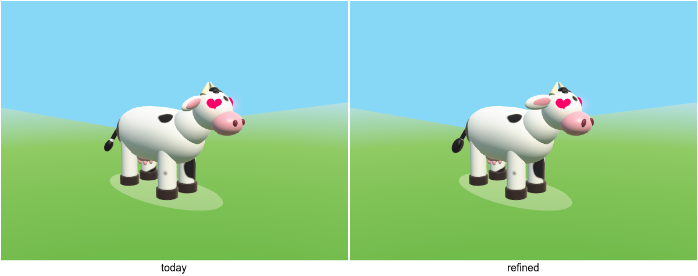

The mockups come from `tools/Art/CowPitch/compare.sh`. It builds `CowPitch`,
renders through the tests' `SnapshotView` in the game's lighting, and assembles
the sheets. Each refinement is an edit to `makeCowParts()` in
`tools/Art/CowPitch/Refinements.cpp`. Nothing in `Lib` changed.

## Worth doing

### Ears: forward, flatter, pink showing

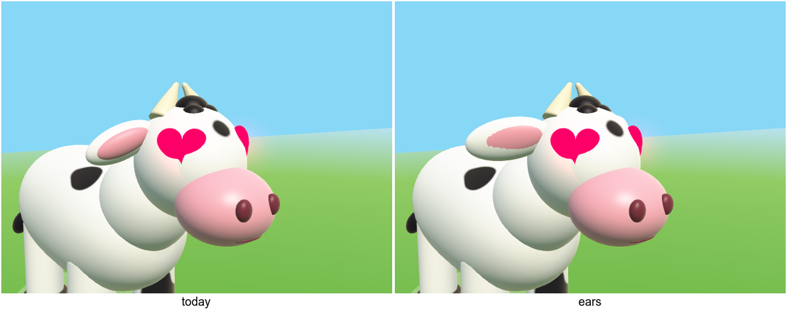

The ears are a little bigger (0.07 × 0.12 × 0.24, up from 0.08 × 0.1 × 0.21),
droop less (0.22, down from 0.45) and turn forward (-0.55, up from -0.25), so
the inner ear's pink faces the camera. This is the only change in the set you
can still see from the chase camera and in the menu.

- **Cost:** two `ball` lines in `addCrown`.
- **Animation:** none. The ears stay on `Head`.
- **Wardrobe:** the cowboy hat clears them (see below). Not checked yet: the
  Beanie, Frog Hat and Cow Bucket Hat, which come down lower. Run
  `Wardrobe/snapshots` and look at those three.

### Nostrils: slanted commas

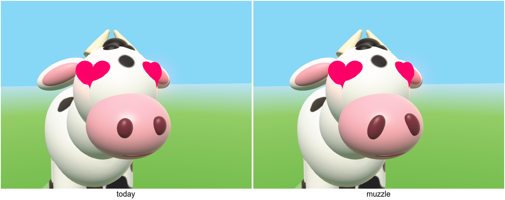

The nostrils are taller (0.07, up from 0.055), slightly bigger, and tilted
0.45 rad outward at the top, so they read as a cow's nose rather than two
buttons. They show in the menu and the editor, where the camera is in her
face.

- **Cost:** one line in `addFace`.
- **Animation and wardrobe:** none.

### Tail tuft: three puffs instead of one ball

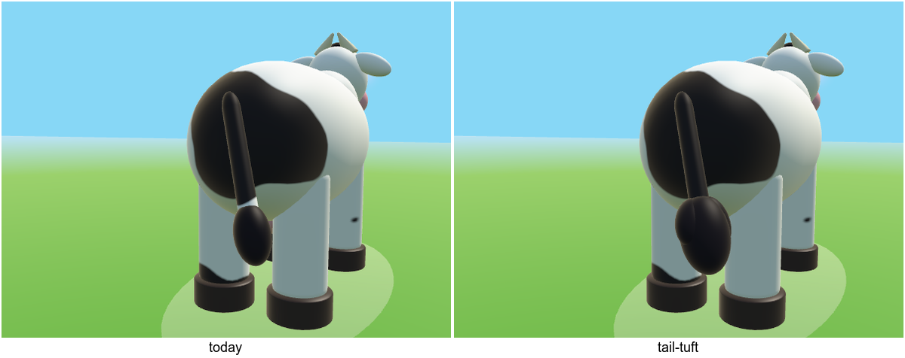

The one dark ball becomes three soft puffs (`softness` 0.4). The chase
camera sits behind her, so the tail is the part of the cow players look at
most.

- **Cost:** replace one part in `addTail` with three. That is 2 spheres more,
  about 6k triangles at detail 1, less at the lower quality tiers.
- **Animation:** the puffs are on `Tail`, so they swish with it.
- **Wardrobe:** the seat's tail hole is above the tuft, so nothing changes.

### All three together

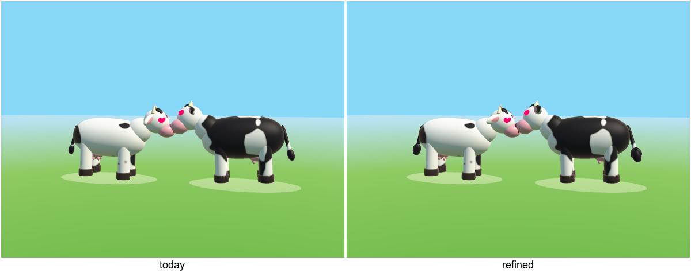

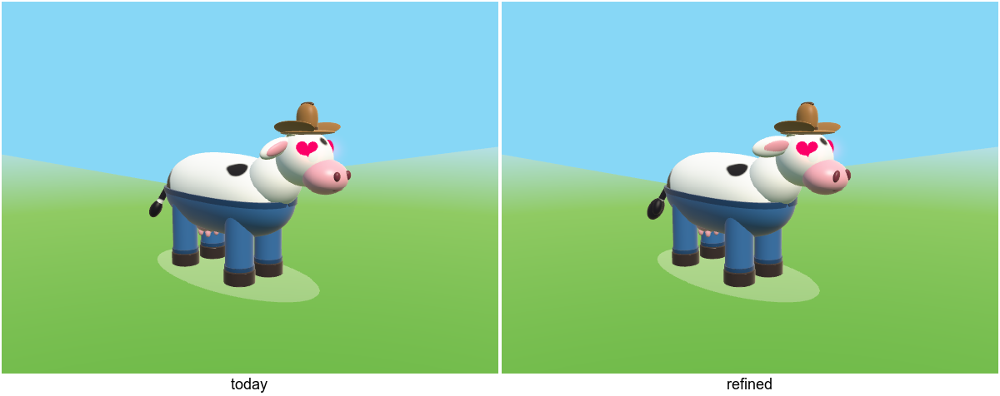

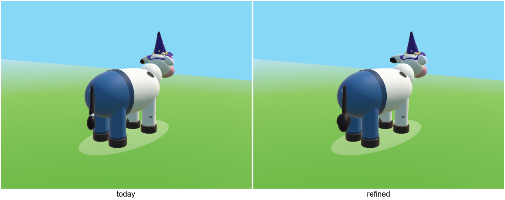

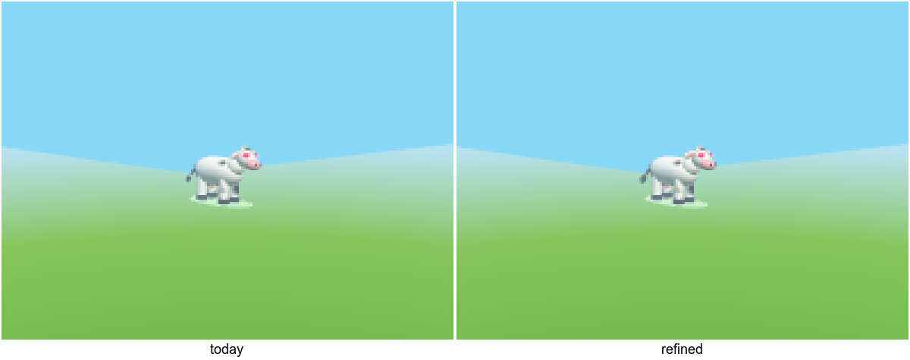

At 16 m on a phone, today's cow and the refined one look the same. That is
the point: she doesn't change, she just gets better in close-up.

## Tried and not worth it

| Change | Verdict |
|---|---|
| Lashes on the hearts | 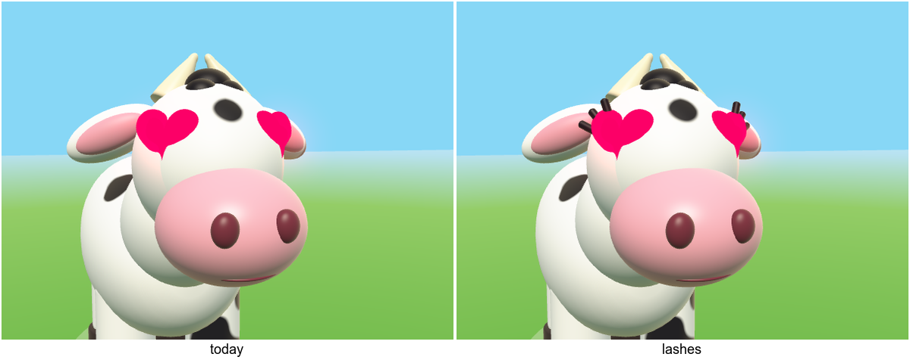 They read as antennae. Hearts already are the eyes, so lashes fight them. |
| Cheek blush | 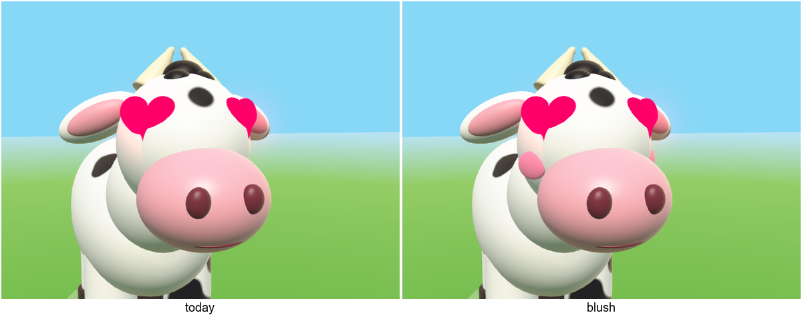 Pink next to a pink muzzle is invisible from the front and muddy at 3/4. |
| Cloven hooves | 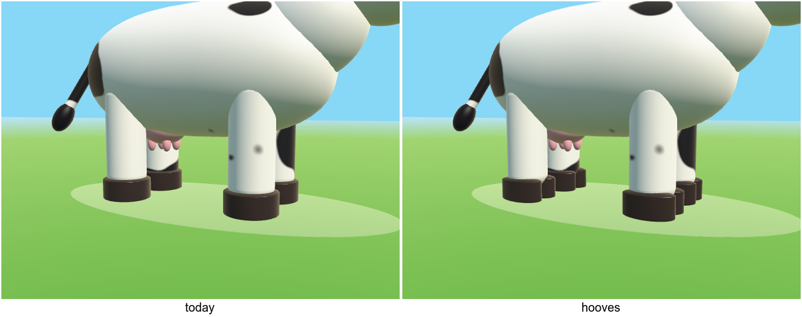 Two toes read as clutter, not as hooves. Today's round pad is cleaner. It also adds 4 parts. |
| Wider stance | 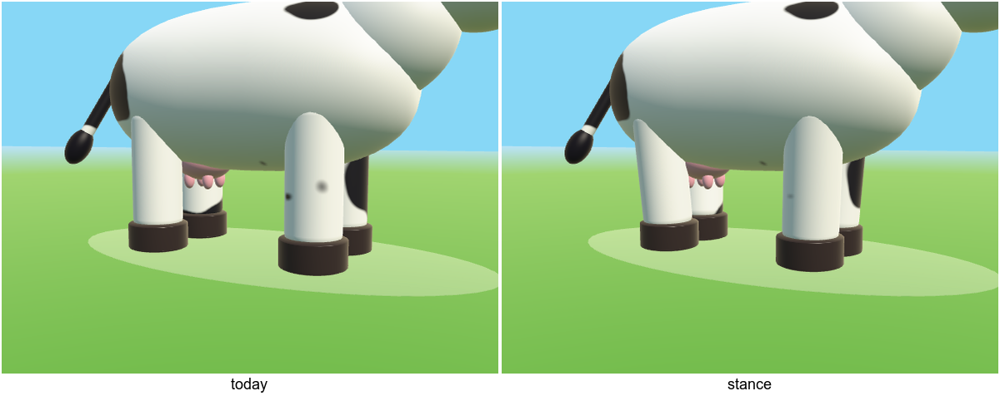 You can't see it. It would also tilt the pants' cuffs, which follow `legPlacements`. |
| Fuller udder | 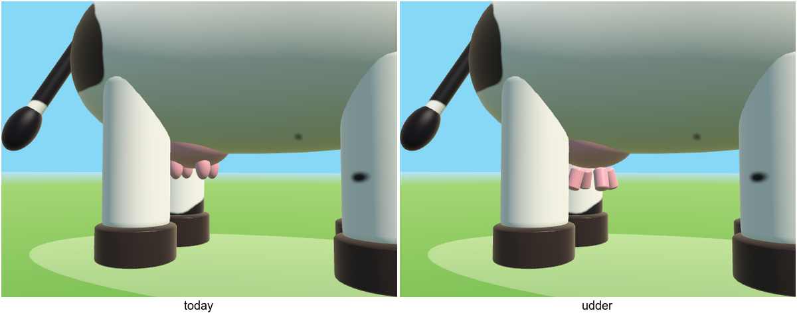 Hidden between the legs from every game camera. The new teats look like fingers. |
| Bigger spots | 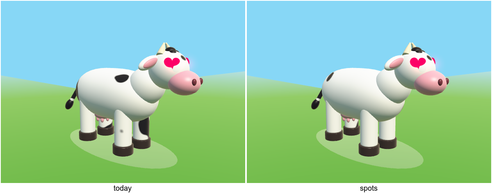 She loses her spots. See the seed lottery below. |
| Softer hide light | 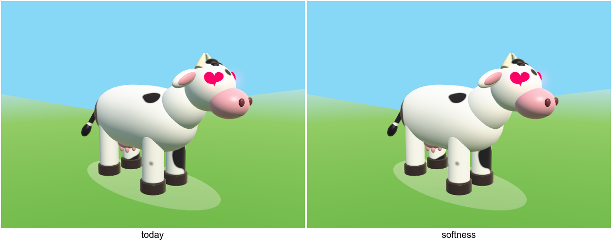 `softness` 0.3 and `gloss` 0.35 are free, but you have to squint to see the difference. Not worth new snapshots. |

### Why bigger spots are a lottery

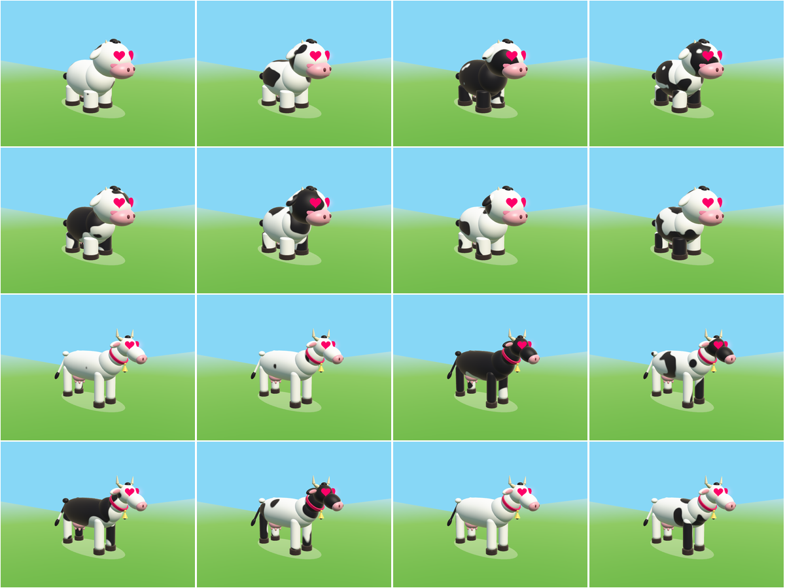

These are eight seeds each, with `spotScale` at 0.7 (top) and 0.5 (bottom).
With bigger spots, the same noise threshold gives anything from an all-white
cow to an all-black one. Today's two fixed seeds (`{0,0,0}` and
`{7.3,2.1,4.6}` in `CowsView`) only look right because the spots are small.
Changing their size means picking both seeds again by eye. A coverage control
in `Material::spots` would avoid that, but it is an Engine shader change, and
nothing here needs it.

## Doing it

1. `Cow/Cow.cpp`:
   - In `addCrown`, set the ear and inner-ear sizes and rotations as in
     `Refinements.cpp`'s `ears`.
   - In `addFace`, use `muzzle`'s nostril size and add a
     `Mat4::rotationX(-0.45f * side)`.
   - In `addTail`, use `tailTuft`'s three puffs.
2. Run `ctest --test-dir build -R Actors`. Look at `actors-cow*`, and at
   `actors-hat-*` for the Beanie, Frog Hat and Cow Bucket Hat against the new
   ears. `Cow/instanceCountIsConstant` counts the parts, so it adapts to the
   two new ones. Nothing in Wardrobe changes.
3. Regenerate the store art with `CowsArt`.

## Appendix: new directions, explored and rejected

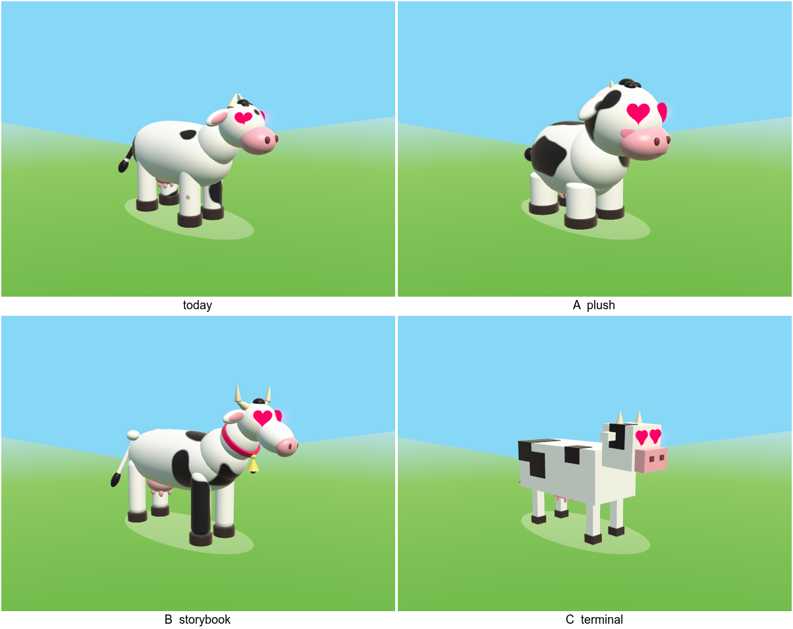

Jamie's verdict on these was "current cow is far superior". They are recorded
here so nobody renders them again. `CowPitch` still renders them into the work
dir.

- **A, plush** (big head, stubby legs, blush). It reads best at a distance,
  but it is a different, more generic toy-cow character and loses her
  proportions.
- **B, storybook** (long body, horns, bell, Holstein patches). It is busy, its
  thin legs and long body turn to noise on a phone, and its horns collide with
  the hats.
- **C, terminal** (the cowsay cow in boxes). It is a cold nod in 3D, clashes
  with the round hats and props, and needs every pair of pants rebuilt.
